# Hybrid Creature Modeling

Skill สำหรับ Claude Code ที่สร้างโมเดล 3D สิ่งมีชีวิต เช่น มังกร ไดโนเสาร์ สัตว์ประหลาด หรือสัตว์เลื้อยคลาน ใน **Blender ด้วย Python** แบบอัตโนมัติ ตั้งแต่สัดส่วนไปจนถึงเกล็ด ฟัน ตา และเวอร์ชันสำหรับเกม

แนวทางนี้มาจาก benchmark ที่สร้างมังกรตัวเดียวกันด้วย 5 วิธี ภายใต้เงื่อนไขเดียวกันทั้งหมด (spec, กล้อง, แสง, palette) แล้วให้คะแนนจากภาพเรนเดอร์และการวัด geometry วิธี **hybrid** ได้คะแนนสูงสุด 46/60 จากนั้นทำ detail pass ต่อ แล้วทดสอบกับสิ่งมีชีวิตตัวใหม่ (raptor สองขา) เพื่อพิสูจน์ว่าใช้ได้ทั่วไป ไม่ได้ใช้ได้แค่กับมังกร


## 🐉 มังกรในแต่ละเวอร์ชัน

ทุกภาพเรนเดอร์ด้วยกล้อง แสง และ palette ชุดเดียวกัน จึงเทียบกันได้ตรงๆ ภาพ clay ไม่มีสีและ normal map เห็นแต่รูปทรงจริง

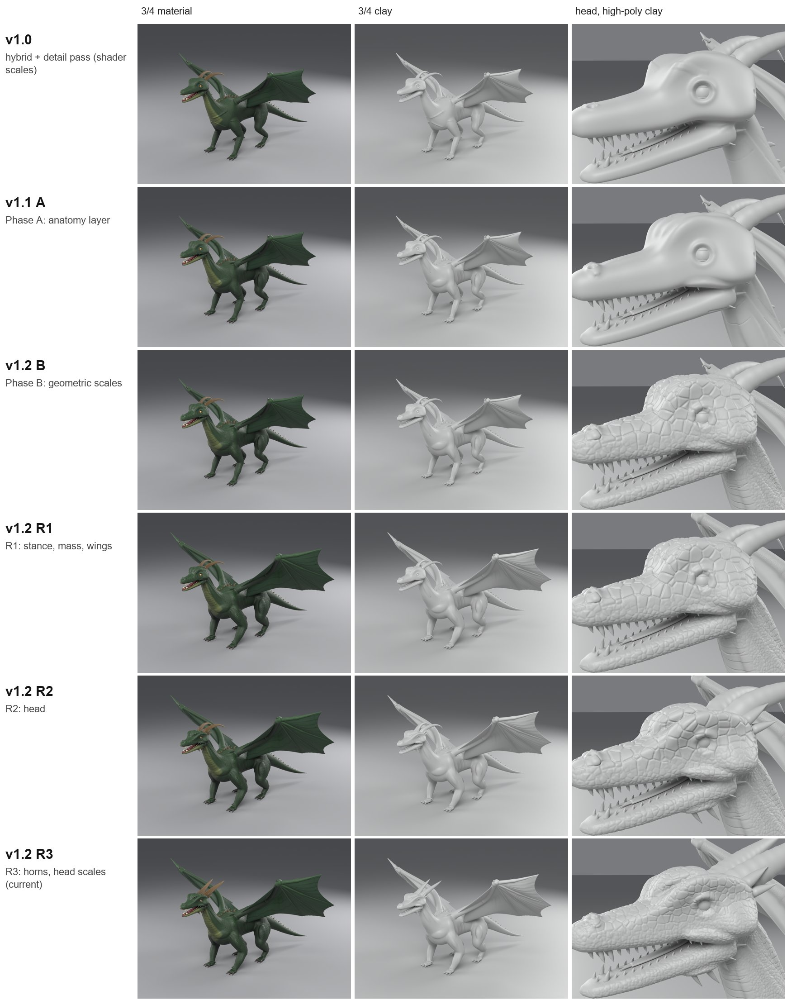

| เวอร์ชัน | ภาพรวม | หัว | สิ่งที่เปลี่ยน |
|---|---|---|---|
| **v1.0** | 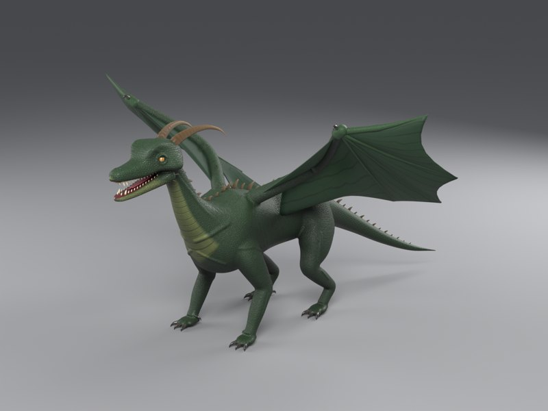 | 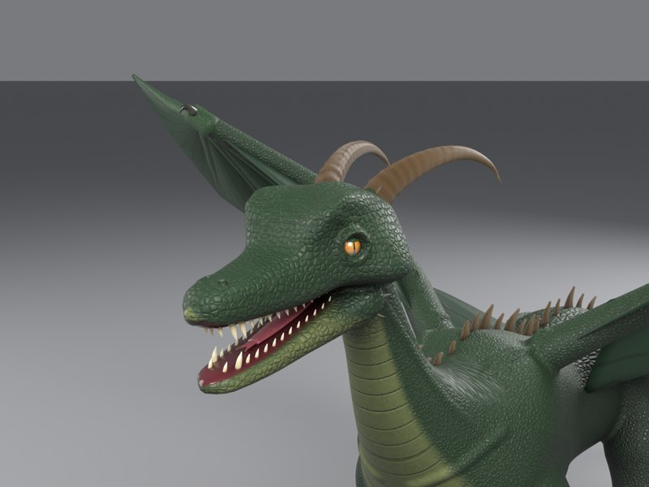 | hybrid pipeline + detail pass: เกล็ดเป็น shader ทั้งหมด จึงมองไม่เห็นในภาพ clay |
| **v1.1** Phase A |  |  | เพิ่มกล้ามเนื้อ เอ็น และสันกระดูก 26 ชิ้นต่อข้าง รูปทรงที่ปั้นเพิ่ม (added form p90) จาก 0.14 เป็น 7.15 mm |
| **v1.2** Phase B | 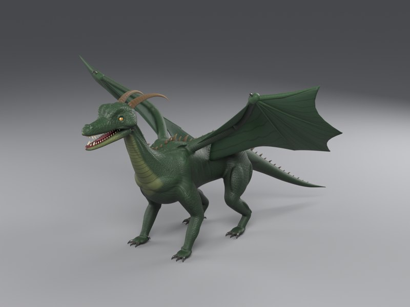 | 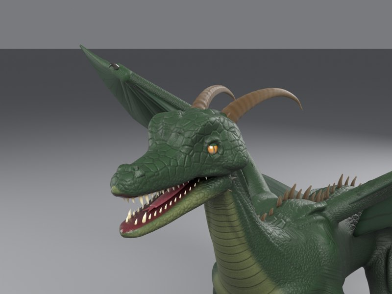 | เกล็ดเป็นผิวจริง fine relief p90 จาก 0.02 เป็น 0.42–0.52 mm (gate ยังไม่ผ่าน) |
| **v1.2** R1 | 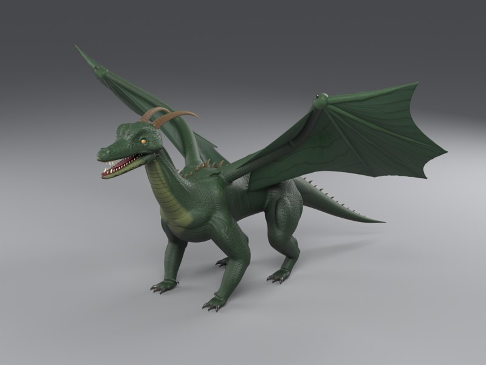 | 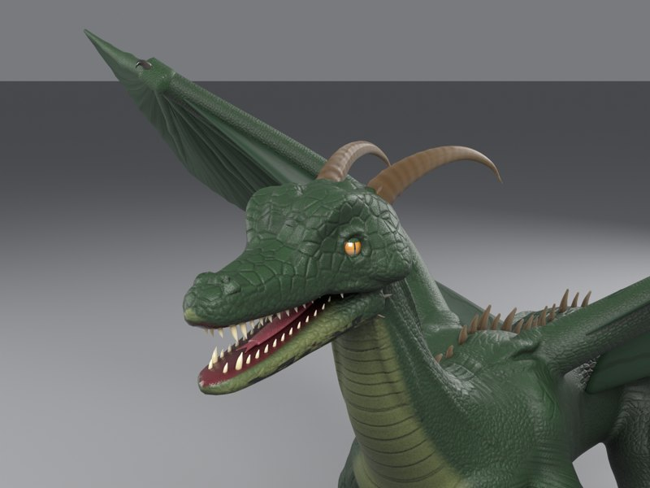 | เริ่มเทียบกับ reference: แขนขาหนาขึ้นราว 30%, ศอกและเข่ากางออก, ปีกยาวจาก 0.90 เป็น 1.08 เท่าของระยะจมูกถึงสะโพก |
| **v1.2** R2 | 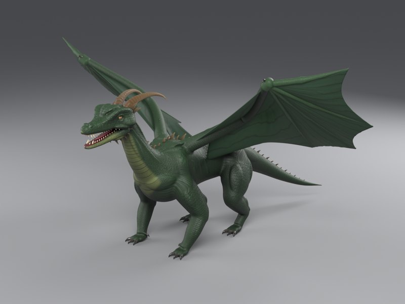 | 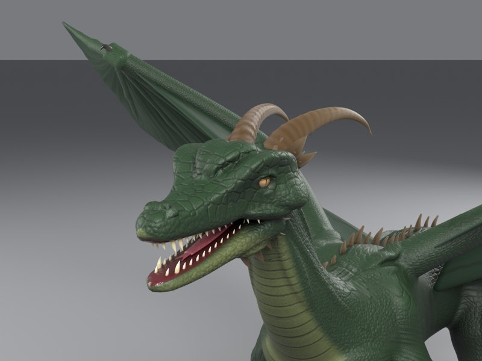 | หัวเหลี่ยม: สันคิ้วยื่นจาก 14 เป็น 26 mm, กะโหลกโค้งน้อยลง, เพิ่มเขาเรียงท้ายกะโหลกและหนามใต้คาง |
| **v1.2** R3 (ปัจจุบัน) | 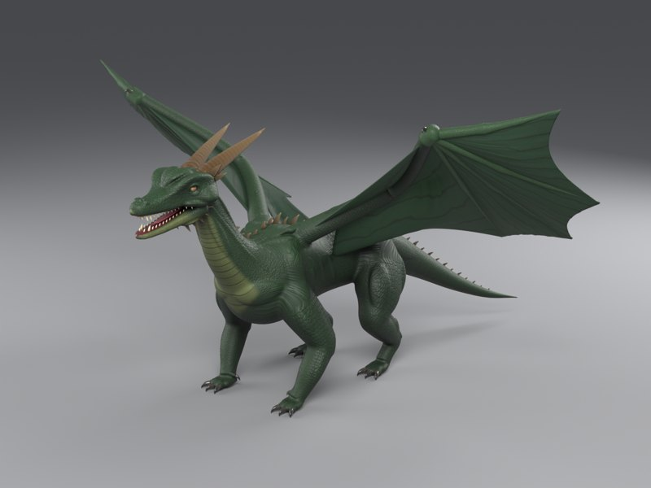 | 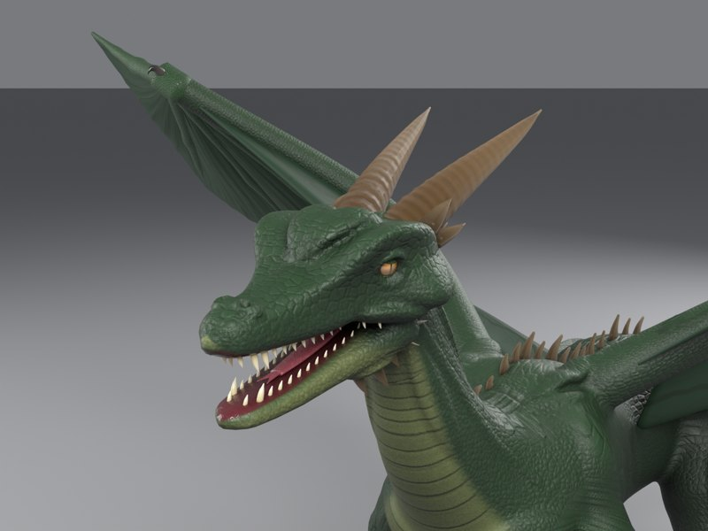 | เขาหลักหนา ตรง และกวาดไปข้างหลัง; เกล็ดบนหัวเล็กลงจาก 13 เป็น 9 mm |

ภาพขนาดเต็มทุกมุม (รวม clay) อยู่ใน [`benchmarks/images/versions/`](benchmarks/images/versions/) รายละเอียดแต่ละเฟสอยู่ในหัวข้อ "กำลังพัฒนาต่อ" ด้านล่าง

## 🚀 จุดเด่น (Key Features)

- **เลือกเทคนิคตามขนาดของรายละเอียด** แต่ละเทคนิคถูกใช้กับปัญหาที่มันแก้ได้ดีที่สุด

  | ขนาดรายละเอียด | เทคนิค |
  |---|---|
  | สัดส่วนหลัก | loft จาก cross-section |
  | รอยต่อแขนขา | voxel fuse + cavity smoothing |
  | กล้ามเนื้อ รอยพับ เอ็น | sculpt ด้วย brush จริงแบบ closed-loop |
  | เบ้าตา จมูก รูหู | procedural displacement |
  | ตา ฟัน ลิ้น เขา กรงเล็บ ปีก | insert แยกชิ้น |
  | เกล็ด | shader ที่อ่านแกนลำตัว |

- **กายวิภาคตรวจด้วยตัวเลข ไม่ใช่ด้วยตา**
  - ขากรรไกรล่างต้องยาวและกว้างรับกับขากรรไกรบน
  - ความยาวฟันถูกจำกัดตามช่องปากที่วัดได้จริง
  - ปลายกรงเล็บต้องอยู่เหนือพื้น
- **เกล็ดหลายชนิดในชิ้นเดียว** วางตามทิศของลำตัวผ่าน body-coordinate field จึงไม่ต้อง retopology เพื่อทำ UV
  - เม็ดเล็ก, เกล็ดหลังมีสัน, เกล็ดท้องเป็นแผ่น, วงหาง, แผ่นหัว, เกล็ดนิ้ว, เกล็ดริมปาก
  - มีสีเข้มด้านหลังจางด้านท้อง (countershading) และลายพาดได้
- **Game version พร้อมใช้**
  - Retopology ผ่านด่านวัดความคลาดเคลื่อนรายส่วน ถ้าไม่ผ่านจะ decimate แทน
  - Bake normal/color 4096 และ roughness/AO 2048 จาก high-res
- **ตรวจผลทุกรอบ**
  - Dry-run แบบ headless ใช้เวลาประมาณ 1 นาที
  - เรนเดอร์ 8 มุมมองมาตรฐานและ 8 ภาพ close-up
  - เปิดไฟล์ใน process ใหม่เพื่อวัดสถิติ
  - exit code ตรงกับผลจริง
- **`creature_kit.py`**: pipeline ทั้งหมดเป็น library สัตว์ตัวใหม่เขียนแค่ข้อมูลกับ builder ไม่กี่ตัว (ตัวอย่าง raptor ประมาณ 230 บรรทัด)

---

## 📊 ผล Benchmark (สรุป)

| อันดับ | วิธี | คะแนน /60 |
|---|---|---|
| 1 | **Hybrid** (skill นี้) | **46** |
| 2 | Advanced procedural (lofting) | 40 |
| 3 | Sculpting อย่างเดียว | 38 |
| 4 | AI image-to-3D (TRELLIS, หลังซ่อม) | 33 |
| 5 | Basic procedural (ประกอบ primitive) | 22 |

| Detail pass (Exp 5 → Exp 6) | ทดสอบกับตัวใหม่: raptor |
|---|---|
|  |  |

รายละเอียด วิธีวัด ภาพทุกการทดลอง และข้อจำกัด อยู่ที่ [`benchmarks/`](benchmarks/README.md)

---

## 🔄 กำลังพัฒนาต่อ: pipeline สำหรับสิ่งมีชีวิตแนวสมจริง (high-fidelity)

แผนการยกระดับเริ่มจาก [audit](benchmarks/upgrade/01_audit.md) ซึ่งวัดจาก geometry พบว่ารายละเอียดผิวของ v1.0 เป็น shader ทั้งหมด (relief 0.04 mm) และเมื่อเรนเดอร์แบบ clay ผิวเรียบทั้งตัว

| เวอร์ชัน | เฟส | ผล |
|---|---|---|
| v1.1.0 | [A: ชั้นกายวิภาค + ขั้น high-poly](benchmarks/upgrade/02_phaseA.md) | เพิ่ม volume ของกล้ามเนื้อ เอ็น และสันกระดูก รวม 26 ชิ้นต่อข้าง หลอมเข้ากับผิว ทำให้ added form (p90) เพิ่มจาก 0.14 เป็น 7.15 mm; high-poly 3.6M tris ปิดเป็นผิวเดียว; มี metric และภาพ clay ใหม่ |
| v1.2.0 | B: เกล็ดที่เป็น geometry (ระดับ 1–2) | เกล็ดเป็นผิวจริง fine relief p90 จาก 0.02 เป็น 0.43–0.53 mm; **ยังไม่ผ่าน gate** (≥ 0.5 mm ผ่าน 2 จาก 5 ส่วน) |
| v1.2.0 | [R: เทียบกับโมเดลอ้างอิงที่สมจริง](benchmarks/upgrade/03_stepR.md) | สคริปต์ค้น reference และขั้น R ใน SKILL.md; มังกร: แขนขาหนาขึ้นราว 30%, ปีกยาวจาก 0.90 เป็น 1.08 เท่าของระยะจมูกถึงสะโพก, หัวเหลี่ยม (สันคิ้วยื่นจาก 14 เป็น 26 mm), เขาหนา ตรง กวาดไปข้างหลัง |
| ถัดไป | gap 4–6 จาก reference | รอยพับคอ, เกล็ดสีข้างเรียงเป็นแถว, เกล็ดหลังเป็นสันสูง; ปิด gate ของ Phase B |

---

## 📦 ติดตั้ง

```
/plugin marketplace add phumrapee47/hybrid-creature-modeling
/plugin install hybrid-creature-modeling@hybrid-creature-modeling
```

อัปเดตเป็นเวอร์ชันล่าสุด:

```
/plugin marketplace update hybrid-creature-modeling
```

**ติดตั้งแบบ manual (personal skill):** คัดลอกโฟลเดอร์ `plugins/hybrid-creature-modeling/skills/hybrid-creature-modeling` ไปไว้ที่ `~/.claude/skills/` แล้วเรียกด้วย `/hybrid-creature-modeling`

### สิ่งที่ต้องมี

- **Blender 5.2** (ทดสอบกับ 5.2.2 LTS) สั่งรันจาก command line ได้
- **GUI session** สำหรับขั้น sculpt เพราะ Blender 5.2 crash เมื่อเข้า sculpt mode แบบ `-b` ขั้นอื่นทุกขั้นรันแบบ headless ได้ (dry-run)
- **GPU (ไม่บังคับ):** CUDA ใช้ได้ ส่วน OptiX ล้มบนเครื่องที่ทดสอบ (RTX 4050 Laptop) ถ้าไม่มี GPU จะ fallback ไป CPU
- **Python + Pillow** สำหรับทำ contact sheet
- **Windows:** ทำงานในโฟลเดอร์ที่ path สั้น เพราะ path ยาวเกิน 260 ตัวอักษรทำให้ Blender เปิดหรือเขียนไฟล์ไม่ได้

---

## 💻 วิธีเรียกใช้งาน

```
/hybrid-creature-modeling:hybrid-creature-modeling สร้างหมาป่าแฟนตาซีสไตล์เกม มีเขาโค้ง ขนเป็นเกล็ด อ้าปากเห็นเขี้ยว
```

หรือพิมพ์คำขอธรรมดา เช่น "สร้างโมเดลไดโนเสาร์ใน Blender แบบมีเกล็ดและฟัน" skill จะถูกเลือกใช้เองจาก description

ลำดับงานที่ skill จะพาทำ:

```text
spec → shape data (spine, cross-section, chain ของแขนขา)
  → dry-run headless → ภาพ preview → แก้ข้อมูล
  → GUI build: loft → subdivide → voxel fuse → sculpt (closed-loop) → displacement
               → mouth profile → body fields → inserts → save high-res
               → retopology gate / decimate → UV → bake → save game
  → เรนเดอร์มาตรฐาน + close-up → ตรวจ → แก้ทีละ defect → เก็บ iteration
```

---

## 🗂️ โครงสร้าง repo

```
├── .claude-plugin/marketplace.json
├── plugins/hybrid-creature-modeling/
│   ├── .claude-plugin/plugin.json
│   └── skills/hybrid-creature-modeling/
│       ├── SKILL.md                 ← คู่มือหลักของ skill
│       ├── scripts/                 ← creature_kit, proc_mesh, sculpt_driver, detail_materials,
│       │                               camera_setup, render_views, render_details, inspect_model ...
│       └── examples/
│           ├── raptor/              ← ตัวอย่างที่ใช้ creature_kit (เริ่มจากตรงนี้)
│           └── dragon_detail.py     ← มังกรฉบับเต็ม (ปีก, เยื่อปีก, ขยายหัว, แก้ขากรรไกร)
└── benchmarks/
    ├── README.md                    ← วิธีทดลอง ผล และข้อจำกัด
    ├── images/                      ← ภาพเปรียบเทียบทุกการทดลอง
    ├── results/                     ← scorecard.csv, comparison_report.md, metrics.json
    └── experiments/                 ← สคริปต์และรายงานของ Exp 1–6
```

---

## ⚠️ ข้อจำกัด

- คะแนนมาจากผู้ประเมินคนเดียว (Claude) ซึ่งตัดสินจากภาพ เป็นการตัดสินใจเชิงคุณภาพ ไม่ใช่การวัด ความคลาดเคลื่อนประมาณ ±1 ต่อหมวด
- ยังไม่ได้ทดสอบ rig, skinning หรือการ import เข้า game engine จริง เพราะ body ของ game mesh เป็น triangle ไม่มี edge loop
- Insert เช่น ฟัน เขา และปีก ยังใช้ procedural material ถ้าจะใช้ใน engine ต้อง bake หรือแปลงเป็น vertex color ก่อน
- ทดสอบบน Windows 11 + Blender 5.2.2 เครื่องเดียว
