# Benchmark: 5 วิธีสร้างมังกร 3D ใน Blender + detail pass + ทดสอบกับตัวใหม่

ชุดทดลองที่ใช้หาว่าวิธีไหนเหมาะที่สุดสำหรับ AI agent ที่สร้างโมเดล 3D สิ่งมีชีวิต ทุกวิธีสร้างมังกรตัวเดียวกันจาก spec เดียวกัน แล้วเรนเดอร์และวัดด้วยชุดเครื่องมือเดียวกัน

> สถานะ: แต่ละวิธีรันครั้งเดียว (มีหลาย revision ภายในวิธี) และให้คะแนนโดยผู้ประเมินคนเดียว จึงยังไม่ใช่ข้อสรุปเชิงสถิติ (ดู [ข้อจำกัด](#ข้อจำกัดที่ควรรู้))

## การตั้งค่าที่เหมือนกันทุกการทดลอง

- **Spec:** มังกรแฟนตาซีขนาดเล็กสำหรับเกม 4 ขา 2 ปีก มีเขา หนามหลัง และกรงเล็บ ([character_specification.md](experiments/shared/character_specification.md))
- **ระบบพิกัด:** หน่วยเมตร, +Z ขึ้น, หันหน้าไป −Y, มี reference bounding box
- **กล้องและแสง:** กล้อง 8 มุม, แสง studio 3 ดวง, Cycles 128 samples + OpenImageDenoise, ไม่มี DOF หรือ bloom ([benchmark_settings.json](experiments/shared/benchmark_settings.json))
- **Material:** palette เดียวกันทุกการทดลอง ([material_palette.py](experiments/shared/material_palette.py))
- **การวัด:** เปิด .blend ใน process ใหม่ด้วย [inspect_model.py](experiments/shared/inspect_model.py) แล้ววัดค่าต่อไปนี้
  - triangle ของ mesh หลังผ่าน modifier
  - shells
  - non-manifold edges
  - % พื้นผิวที่ถูกฝังอยู่ใน mesh อื่น
  - bounding box
  - ขนาดไฟล์
- **เครื่องที่ใช้:** Windows 11, Blender 5.2.2 LTS, RTX 4050 Laptop (CUDA)

## คะแนน (6 หมวด × 10)

| การทดลอง | Silhouette | Volume | Anatomy | Mesh/Shading | Materials | Real-time | **รวม /60** |
|---|---|---|---|---|---|---|---|
| Exp 1 Basic procedural | 5 | 3 | 4 | 3 | 4 | 3 | **22** |
| Exp 2 Advanced procedural | **8** | 6 | 7 | **7** | 6 | 6 | **40** |
| Exp 3 Sculpting | 7 | 7 | 7 | 6 | 7 | 4 | **38** |
| Exp 4 AI (TRELLIS) ตามที่ได้มา | 6 | 5 | 5 | 3 | 4 | 5 | *28* |
| Exp 4 AI หลังซ่อม | 6 | 5 | 5 | 5 | 5 | **7** | **33** |
| **Exp 5 Hybrid** | **8** | **8** | **8** | **7** | **8** | **7** | **46** |

หลักฐานประกอบทุกคะแนนอยู่ใน [results/scorecard.csv](results/scorecard.csv) และวิเคราะห์ละเอียดใน [results/comparison_report.md](results/comparison_report.md)

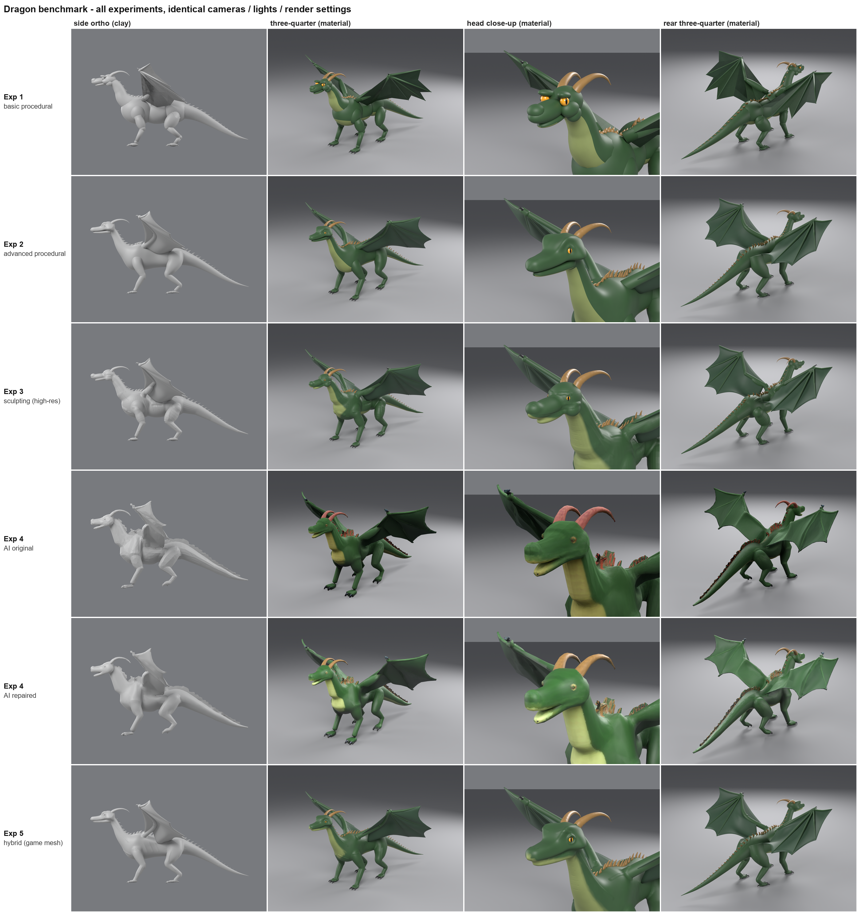
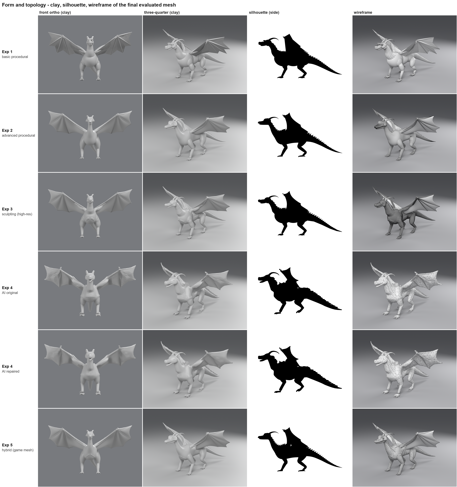

## ตัวเลขด้านประสิทธิภาพ

| | Exp 1 | Exp 2 | Exp 3 | Exp 4 (ดิบ → ซ่อม) | Exp 5 | Exp 6 |
|---|---|---|---|---|---|---|
| Triangles (game) | 38,940 | 171,256 | 505,342 | 8,337 | 44,600 | 76,528 |
| เวลาสร้าง | 1.7 s | 0.47 s | 61 s | 27 s + 3 s | 36 s | 122 s |
| Shells / non-manifold | 156 / 192 | 102 / 10 | 64 / 10 | 211 / 3,565 → 2 / 9 | 74 / 0 | 141 / 80¹ |
| พื้นผิวที่ถูกฝัง | 42 % | 21 % | 3.5 % | 0 % | 10 % | 9.5 % |
| ต้องใช้ GUI | ไม่ | ไม่ | ใช่ (sculpt) | ไม่ (ใช้บริการภายนอก) | ใช่ | ใช่ |

¹ Exp 6: non-manifold 80 edges คือขอบของ cornea ที่ตั้งใจทำเป็นฝาเปิด ส่วน shells ที่เพิ่มขึ้นคือฟันและเปลือกตาที่เป็นชิ้นแยก

## ภาพแต่ละการทดลอง

| Exp 1 Basic procedural | Exp 2 Advanced procedural |
|---|---|
| 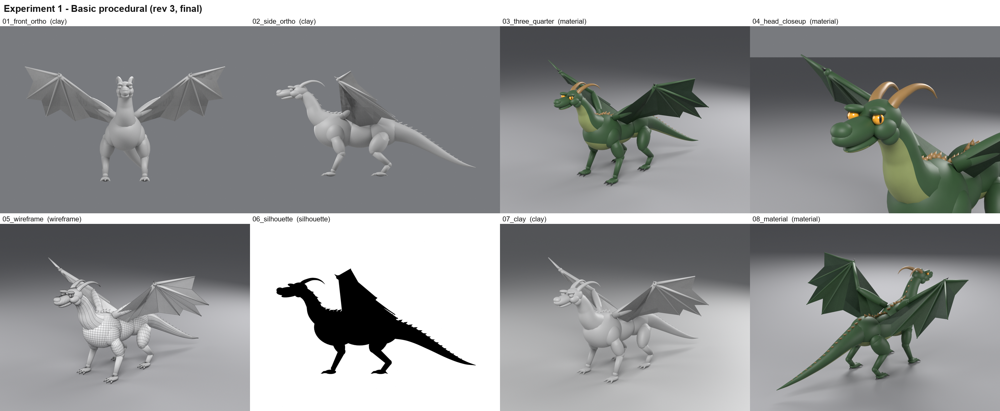 | 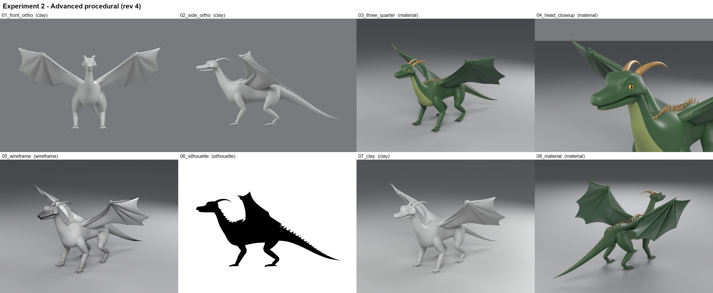 |
| **Exp 3 Sculpting** | **Exp 4 AI: ตามที่ได้มา / หลังซ่อม** |
| 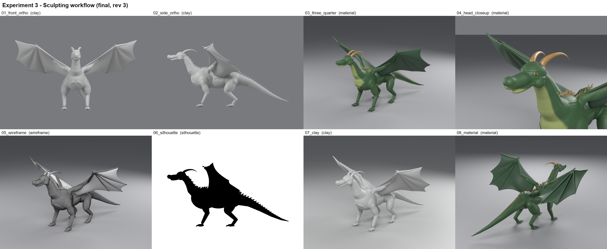 | 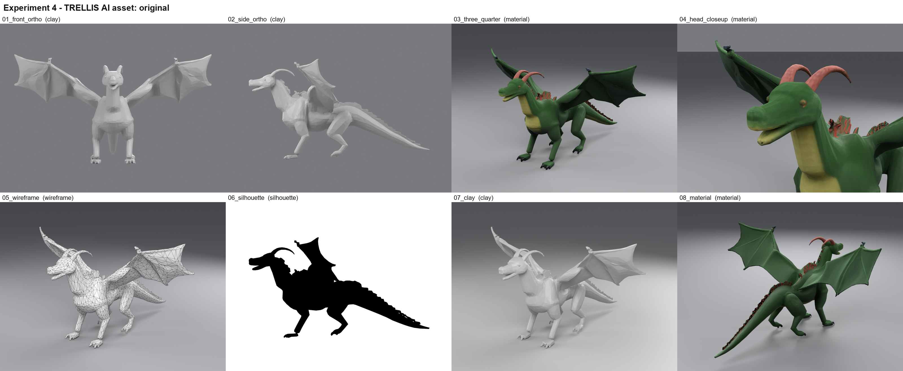 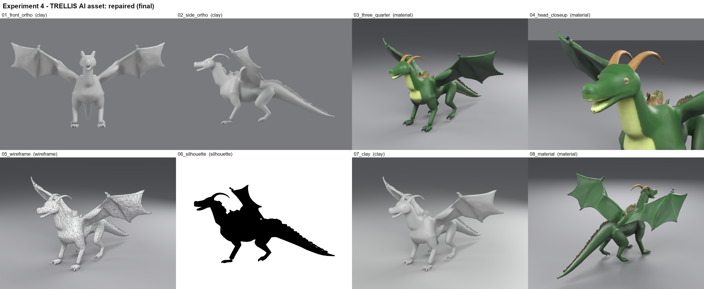 |
| **Exp 5 Hybrid** | **Exp 6 Detail pass (game version)** |
| 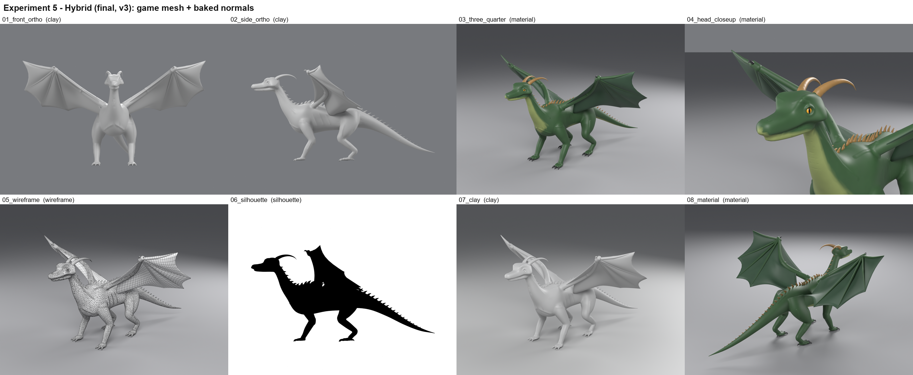 | 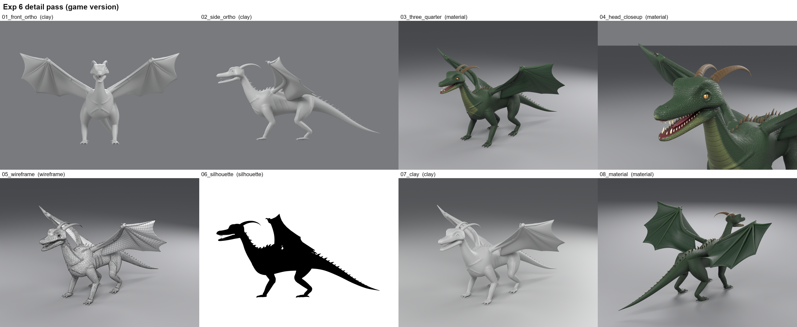 |

## Exp 6: Detail pass (ต่อยอดจาก Exp 5)

เพิ่มกายวิภาคและรายละเอียดผิวทุกส่วน โดยเลือกเทคนิคตามขนาดของรายละเอียด:

| ขนาดรายละเอียด | เทคนิค | สิ่งที่ทำ |
|---|---|---|
| สัดส่วน | แก้ข้อมูล loft | หัว ×1.12 อ้าปาก 12° อกและหลังใหญ่ขึ้นสำหรับกล้ามเนื้อบิน |
| ส่วนประกอบแยกชิ้น | geometry insert | ฟัน 26 ซี่ มีเขี้ยว (ความยาวจำกัดตามช่องปากที่วัดได้) ลิ้นแฉก กระจกตา เปลือกตาบนล่าง หนามแก้ม นิ้วเท้าเสริม (dewclaw) หนามหลังสลับใหญ่เล็ก กรงเล็บไม่จมพื้น |
| กล้ามเนื้อและรอยพับ | sculpt แบบ closed-loop | กล้ามเนื้อบิน masseter เอ็นร้อยหวาย เอ็นแขน รอยพับรักแร้ ขาหนีบ คอ และโคนปีก (41 stroke เข้าเป้าทั้งหมด) |
| ลักษณะที่ต้องแม่นยำ | procedural displacement | เบ้าตา รูจมูกที่ลึกขึ้น รูหู |
| พื้นผิว | shader + body field | เกล็ด 7 ชนิด เหงือก ม่านตาและรูม่านตาแนวตั้ง เส้นเลือดปีกโปร่งแสง เขามีวงปีและเส้นใย |
| Game version | decimate + bake | body 32k triangle คลาดจาก sculpt สูงสุด 1.5 มม. (เฉลี่ย 0.1 มม.) bake 4K ใช้เวลาประมาณ 40 วินาที |

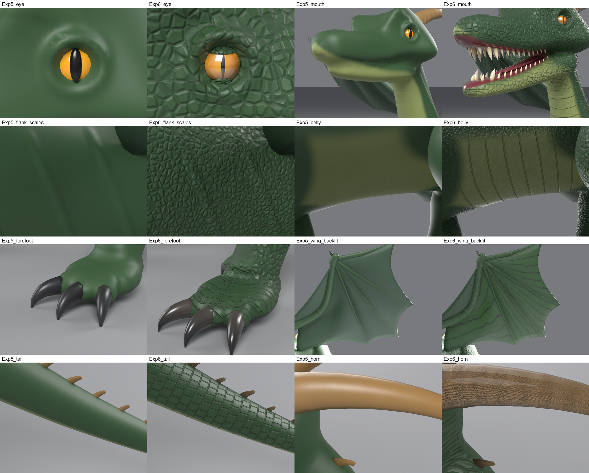

**รอบแก้ (v1 → v2):** ผู้ใช้ทักว่าขากรรไกรบนกับล่างไม่เท่ากัน วัดแล้วพบว่าขากรรไกรล่างที่ใช้ต่อจาก Exp 2 สั้นกว่าขากรรไกรบน 5.3 ซม. และกว้างเพียง 59–69% ตอนปิดปากซ่อนอยู่ใต้หัวจึงไม่เห็น พออ้าปากจึงปรากฏ v2 สร้างขากรรไกรใหม่ตามกายวิภาคของสัตว์เลื้อยคลาน ให้ปลายห่างปลายจมูก 1.3 ซม. และกว้าง 86–89% ของขากรรไกรบน

Exp 6 **ยังไม่ได้ให้คะแนน**ด้วย scorecard เดียวกัน ใช้การเทียบภาพก่อน/หลังเท่านั้น

## ทดสอบกับตัวใหม่: raptor (เพื่อพิสูจน์ว่า skill ใช้ได้ทั่วไป)

สร้าง raptor สองขาด้วย `creature_kit` จากข้อมูลประมาณ 230 บรรทัด ([raptor.py](../plugins/hybrid-creature-modeling/skills/hybrid-creature-modeling/examples/raptor/raptor.py)) กายวิภาคต่างจากมังกรเกือบทั้งหมด:

- ยืนสองขา สะโพกอยู่เหนือเท้า หางใช้ถ่วงสมดุล
- นิ้วเท้าที่ 2 ยกขึ้นและมีกรงเล็บเคียว
- มือสามนิ้ว
- ไม่มีปีก
- ลายพาดหลัง

ผล:
- **Dry-run:** ผ่านตั้งแต่รอบแรก ไม่มี error
- **แก้จากภาพ preview 4 จุด:** ระยะลายพาดผิด (bug สูตร scale ของ Wave texture) ต้นขาโผล่เหนือแนวหลัง คอบาง และกรงเล็บมือยาวตรงเกินไป
- **GUI build:**
  - ไม่มี error และ sculpt 28 stroke เข้าเป้าทั้งหมด
  - body 32k triangle คลาดจาก sculpt สูงสุด 0.9 มม.
  - ทั้งตัว 52k triangle
  - พื้นผิวที่ถูกฝัง 1.7%
  - ปลายกรงเล็บอยู่เหนือพื้น 2.6 มม.
  - สร้างเสร็จใน 148 วินาที

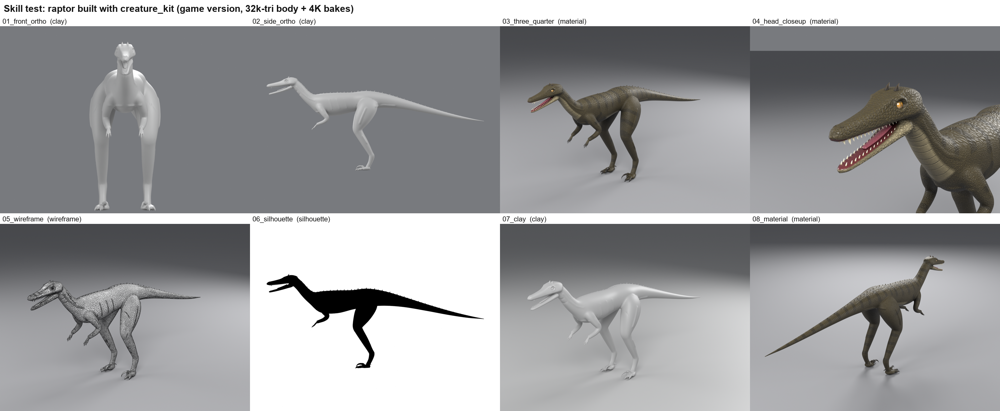
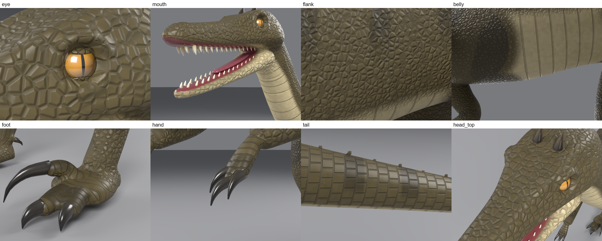

ที่ยังไม่ดี:
- ด้านหน้าต้นขายังดูเป็นแผ่นแบนเล็กน้อย
- ขาค่อนข้างเรียว
- ยังไม่มีขนนก ตั้งใจทำเป็น raptor มีเกล็ดแบบ stylized

## ข้อจำกัดที่ควรรู้

- **ผู้ประเมินคนเดียว:** Claude เป็นทั้งผู้สร้างและผู้ให้คะแนนจากภาพ ความคลาดเคลื่อนประมาณ ±1 ต่อหมวด ส่วนต่าง Exp 2 กับ Exp 3 (2 คะแนน) จึงอยู่ในช่วงคลาดเคลื่อน
- **ยังไม่ได้ทดสอบใน engine จริง:** ไม่มี rig, skinning, LOD และไม่ได้ import เข้า game engine
- **Exp 4 อ้างอิงงานตัวเอง:** ภาพ input ของ Exp 4 คือภาพเรนเดอร์จาก Exp 3 จึงวัดความแม่นในการ *สร้างซ้ำ* ไม่ได้วัดความสามารถในการออกแบบ และทดลองได้แค่ 1 seed เพราะติด quota ของบริการฟรี
- **Sculpt แบบสคริปต์ไม่เท่าศิลปิน:** สิ่งที่ทดสอบคือสิ่งที่ agent ทำได้เองอัตโนมัติ ไม่ใช่สิ่งที่ศิลปินที่ปั้นด้วยมือทำได้
- **ไม่มีไฟล์ใหญ่ใน repo:** ไม่ได้ใส่ไฟล์ .blend (3–68 MB ต่อไฟล์) และภาพเรนเดอร์ทุกภาพ แต่สร้างใหม่ได้จากสคริปต์ใน [experiments/](experiments) ลิงก์ไปยัง `renders/` ในรายงานของแต่ละการทดลองจึงชี้ไปยังไฟล์ที่ไม่ได้อยู่ใน repo

## ไฟล์

- `images/`: contact sheet ของทุกการทดลอง ภาพเปรียบเทียบ และผลทดสอบ raptor
- `results/`: `scorecard.csv` (คะแนน + หลักฐาน + metric), `comparison_report.md`, `metrics.json`
- `experiments/`: สคริปต์ Blender และ `report.md` ของ Exp 1–6 รวมถึง `shared/` (rig, palette, ตัวช่วย) และ `comparison/` (สคริปต์รวมผล)
