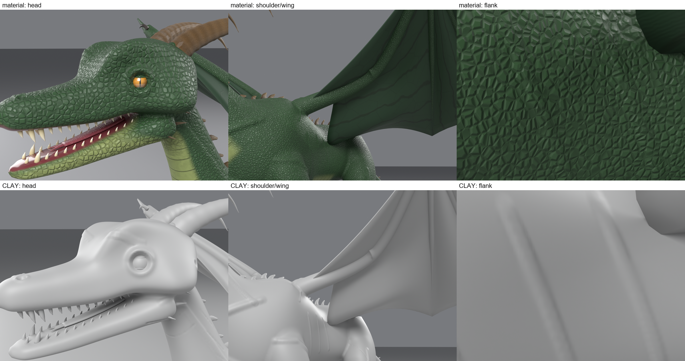

# Phase 1: Audit ของ `hybrid-creature-modeling` v1.0.0

เป้าหมายคือยกระดับ skill ให้ใกล้ภาพ reference: sculpt มังกรแบบสมจริง มีเกล็ดที่เป็น geometry จริง กล้ามเนื้อชัด และปีกเป็นระบบกายวิภาค

## 1. Baseline ที่ใช้เทียบ (ทำซ้ำได้)

| | |
|---|---|
| โค้ด | skill ที่ติดตั้งอยู่ `~/.claude/skills/hybrid-creature-modeling` (ตรงกับ commit `48f7c49` บน GitHub) |
| โมเดล | มังกร Exp 6 v2 high-res และ raptor (ทดสอบ skill) high-res |
| วิธีวัด | `scripts/quality_metrics.py` (ใหม่) วัดจาก **geometry อย่างเดียว** ไม่นับ shader |
| วิธีดู | `render_details.py --clay` (เพิ่มตัวเลือกใหม่) ตัด material, bump และ normal map ออก เหลือแต่รูปทรงจริง |

**Relief** = ระยะห่างตามแนว normal ระหว่างผิวจริงกับผิวเดียวกันหลังถูกทำให้เรียบ (Taubin smoothing) ค่าสูงแปลว่ามีรูปทรงนูนเว้าจริง ส่วน shader bump มองไม่เห็นในค่านี้

| วัดจาก geometry | มังกร | raptor | เทียบ: หนามหลังของมังกร |
|---|---|---|---|
| ความละเอียด mesh (ความยาว edge มัธยฐาน) | 3.17 mm | 3.24 mm | 5.9 mm |
| Relief ละเอียด (ระดับเกล็ด/รอยย่น) p50 / p90 / p99 | **0.01 / 0.04 / 0.26 mm** | 0.01 / 0.04 / 0.25 mm | 0.23 / **1.93** / 5.23 mm |
| Relief กลาง (ระดับแผ่นเกล็ด/กล้ามเนื้อเล็ก) p90 | 0.16 mm | 0.17 mm | – |
| Relief ละเอียด p90 แยกช่วงลำตัว (หัว→หาง) | 0.05 / 0.04 / 0.03 / 0.03 / 0.03 mm | 0.07 / 0.03 / 0.04 / 0.03 / 0.03 mm | – |
| จำนวนเกล็ดที่เป็น geometry | **0** | **0** | – |
| เยื่อปีก (2 ข้าง) | 5,808 tris, edge 42.6 mm, หนาเท่ากันทั้งแผ่น 6 mm | ไม่มีปีก | – |

ค่า relief บนหนามหลังที่ 1.9 mm ยืนยันว่าเครื่องมือวัดจับ geometry จริงได้ ส่วนผิวลำตัวอยู่ที่ 0.04 mm หมายความว่า **ผิวเรียบเกือบสนิททุกส่วนของตัว**

แถวบนคือภาพที่มี material ส่วนแถวล่างคือภาพเดียวกันแบบ clay พอตัด shader ออก เกล็ดทั้งหมดหายไป หัวกลายเป็นท่อเรียบที่มีห่วงรอบตา ข้างลำตัวเรียบเหมือนพลาสติก และปีกเป็นแผ่นแบนหนาเท่ากันทั้งแผ่น

## 2. สิ่งที่ทำได้จริง เทียบกับสิ่งที่เขียนไว้ใน SKILL.md

| ความสามารถ | สถานะ | หลักฐาน |
|---|---|---|
| Loft, voxel fuse, cavity fillet, sculpt stroke แบบ closed-loop | **ทำได้จริง ทดสอบแล้ว** | มังกร 41 stroke และ raptor 28 stroke เข้าเป้าทั้งหมด |
| เบ้าตา จมูก หู (displacement) | ทำได้จริง | log บันทึกจำนวน vertex ที่ถูกขยับ |
| ฟัน ลิ้น ตา กระจกตา เปลือกตา กรงเล็บไม่จมพื้น | ทำได้จริง | ภาพ close-up และค่า z ต่ำสุด +1.1 / +2.6 mm |
| เกล็ด 7 ชนิด | **เป็น shader bump อย่างเดียว** (bump distance 1.2 mm) | grep เจอ `Bump` 21 จุด ไม่มี Multires ไม่มี Displace modifier ไม่มี Geometry Nodes; relief 0.04 mm |
| เส้นเลือดปีก | shader อย่างเดียว | เยื่อปีกมี edge 42.6 mm จึงเก็บรูปทรงใดๆ ไม่ได้ |
| ปีกใน `creature_kit` | **ไม่มี** มีแค่ใน `examples/dragon_detail.py` | grep "membrane" ใน kit ได้ 0 |
| Retopology แบบ quad | **มีโค้ด แต่ไม่เคยผ่าน gate** (0/4 runs) ทุกครั้งตกไปใช้ decimate | log ของ Exp 5, Exp 6 v1/v2, raptor |
| Retopology จาก quad cage ของ loft | เขียนไว้ว่า "ควรทดสอบต่อ" ยังไม่ได้ทำ | – |
| Quality gate | มีบางส่วน: deviation, stroke target, claw z, ผลการ bake **ไม่มี gate แยกหมวด** | – |
| วิจารณ์ภาพอัตโนมัติ | **ไม่มีในโค้ด** Claude ดูภาพเองแล้วจดผล | – |
| พร้อม deform / Roblox | **ไม่ได้ทดสอบ** | – |

## 3. ทำไมยังดูไม่สมจริง

1. **รายละเอียดทั้งหมดเป็นแสงเงา ไม่ใช่รูปทรง** เกล็ดใน reference นูนจริง 3–15 mm ซ้อนกัน มีทิศทาง ขอบเกล็ดตัด silhouette และมีหนามเรียงเป็นแนวตามคอ ของเรามี relief 0.04 mm และขอบ silhouette เรียบสนิท
2. **เพดานความละเอียดและความลึกของงาน sculpt**
   - ทั้งตัวเป็น voxel mesh ชั้นเดียวที่ 3.2 mm (890k tris) จึงเก็บอะไรเล็กกว่าประมาณ 7 mm ไม่ได้ ไม่มีขั้น Multires หรือ displacement ความละเอียดสูง
   - Sculpt มีประมาณ 30–40 stroke ที่ใส่พิกัดด้วยมือ ลึก 1.5–7 mm ทำให้กล้ามเนื้อเป็นก้อนนุ่มกลมๆ
   - Reference น่าจะ sculpt ด้วยมือที่ระดับหลายสิบล้าน polygon
3. **รูปทรงหลักมาจาก superellipse loft ที่มีจุดคุมน้อย**
   - หน้าตัดสมมาตรทั้งหมด แต่ละส่วนมีจุดคุมแค่ 7–15 จุด แขนขาจึงเป็นท่อติดตุ่ม
   - ไม่มีจุดสังเกตของกระดูก เช่น zygomatic arch, occipital crest, scapula spine, olecranon, pelvis
   - ปีกคือนิ้วเป็นท่อบางกับแผ่น Coons ที่ solidify ไม่มีสันกระดูก รอยพับจากแรงตึง ขอบปีกที่หนาขึ้น หรือเส้นเลือดที่เป็น geometry
   - เยื่อปีกเป็น object แยกจากนิ้ว จึงมีรอยต่อ

## 4. ข้อจำกัด 3 อันดับแรก (เรียงตามผลกระทบ)

1. **ไม่มีเกล็ดที่เป็น geometry ทั้ง 3 ระดับ** เกล็ดทั้งหมดอยู่ใน shader (ระดับ 3) ส่วนระดับ 1 (แผ่นใหญ่) และระดับ 2 (เกล็ดนูนรายเม็ด) ไม่มีเลย
2. **ไม่มีขั้น high-poly** mesh ละเอียดแค่ 3.2 mm และใช้ stroke ด้วยมือ งาน sculpt จึงตื้นและหยาบเกินจะรับระดับรายละเอียดที่ต้องการ
3. **กายวิภาคของรูปทรงหลักและปีกยังหยาบ** ไม่มีชั้นกระดูกและกล้ามเนื้อ ปีกไม่ใช่ระบบกายวิภาค

## 5. แผนพัฒนา (ทำทีละเฟส แต่ละเฟสต้องผ่าน gate ก่อนไปต่อ)

งบฮาร์ดแวร์: RAM 15 GB, GPU 6 GB เป้า high-poly ของลำตัวคือ 6–10 ล้าน tris (ความละเอียดประมาณ 1.2–1.6 mm)

| ลำดับ | เฟสในโจทย์ | ทำอะไร | Gate ที่ต้องผ่าน (วัดได้) |
|---|---|---|---|
| **A** | 2 + 3 | **ชั้นกายวิภาค + ขั้น high-poly**: เพิ่มชั้นกระดูกและกล้ามเนื้อ (ทรงที่มีจุด origin/insertion) แล้ว fuse ด้วย voxel แทนการ inflate ทีละ stroke จากนั้นเพิ่ม mesh ให้ละเอียดขึ้น (Multires หรือ remesh ละเอียด) พร้อมระบบ displacement ที่คำนวณด้วย numpy | ภาพ clay อ่านกายวิภาคออกโดยไม่ต้องมี material; relief กลาง p90 สูงกว่า baseline ชัดเจน; มีจุดสังเกตกระดูกที่ระบุได้; ไม่มี mesh ทะลุกัน |
| **B** | 4 + 5 | **เกล็ด geometry 3 ระดับ**: กระจายแผ่นเกล็ดแบบ blue-noise ตามแกนลำตัว ขนาด ทิศ และรูปทรงต่างกันตามส่วน (หัว คอ หลัง ท้อง ข้อพับ แขนขา หาง) แล้ว**สร้างเป็น height field ที่ displace ผิวจริง** มีรูปทรงซ้อนเกล็ด (ขอบเกล็ดยกขึ้นทางด้านหลัง) ทำให้เกล็ดเป็นเนื้อเดียวกับผิว ไม่ลอย ระดับ 3 เป็น normal/bump เหมือนเดิม | Relief ละเอียด p90 ≥ 0.5–1 mm **ทุกช่วงของลำตัว**; ภาพ clay เห็นเกล็ดรายเม็ด; ไม่มีรอยต่อหรือลายถูกยืดที่รอยต่อแขนขา |
| **C** | 6 | **ปีกเป็นระบบ**: นิ้วมีข้อต่อ เยื่อปีกละเอียดประมาณ 5 mm เส้นเลือดและสันนูนเป็น geometry ขอบปีกหนาขึ้น รอยพับจากแรงตึงระหว่างนิ้ว และ fuse เยื่อปีกกับนิ้วให้เป็นเนื้อเดียว | ไม่มีรู ไม่ทะลุกัน ไม่มีชิ้นลอย; ภาพ clay และภาพ backlight เห็นสัน รอยพับ และเส้นเลือด |
| **D** | 7 | **หัว เขา กรงเล็บ**: กะโหลกมีจุดสังเกตกระดูก เขางอกจากฐานที่ fuse กับกะโหลก กลุ่มหนามแก้มและคอ (แบบ reference 2) กรงเล็บมีปลอกหุ้มนิ้ว | Close-up แบบ clay ผ่าน; ฟันยังผ่านกฎเดิม |
| **E** | 8 | **Material ตาม geometry**: แยกผิวเกล็ดนูนกับผิวร่องเกล็ดด้วยค่า curvature/cavity ที่วัดจาก mesh จริง แยก material ตาม 9 ชนิดที่โจทย์ระบุ | Material ไม่ทำให้ภาพ clay ดูต่างไปจากเดิม; ไม่มันวาว ไม่มีลายซ้ำชัด |
| **F** | 9–11 | **Gate แยกหมวด + ลูปวิจารณ์ภาพ + game-ready**: `quality_gates.py` ให้ผล PASS/FAIL แยก 9 หมวด; ทำ before/after sheet อัตโนมัติ; retopology จาก quad cage ของ loft เพื่อให้มี edge loop ไว้ deform; Roblox ต้องตรวจข้อกำหนดล่าสุดและทดสอบ import จริงก่อน | Gate ทุกหมวดมีตัวเลขรองรับ; มีไฟล์ high-poly กับ game แยกกัน; ยังไม่ประกาศว่ารองรับ Roblox จนกว่าจะทดสอบผ่าน |

เหตุผลของลำดับ: A ต้องมาก่อน เพราะเกล็ดที่เป็น geometry ต้องการ mesh ละเอียดและรูปทรงที่ถูกต้องอยู่ข้างใต้ โจทย์ห้ามใช้รายละเอียดผิวปกปิดรูปทรงที่ผิด ส่วน B เป็นช่องว่างที่มองเห็นได้มากที่สุด

## 6. ความคาดหวังที่ตรงไปตรงมา

- Reference เป็นงานระดับภาพยนตร์ ศิลปิน sculpt ด้วยมือเป็นสัปดาห์ด้วย alpha เกล็ดที่วางทีละเม็ด อัตโนมัติด้วยสคริปต์ใน Blender น่าจะเข้าใกล้ได้มาก เช่น เกล็ด geometry ทุกส่วน กายวิภาคชัด และปีกที่เป็นระบบ แต่**ไม่รับประกันว่าจะเท่า reference** และทุกเฟสจะวัดเทียบกับ baseline นี้ ไม่ใช่เทียบกับความรู้สึก
- ไม่ใช้ซอฟต์แวร์ที่ต้องเสียเงิน เช่น ZBrush จนกว่าจะได้รับอนุญาต ถ้าบางจุดต้องปั้นด้วยมือ จะบันทึกขั้นตอนการส่งต่องานไว้ชัดเจน
