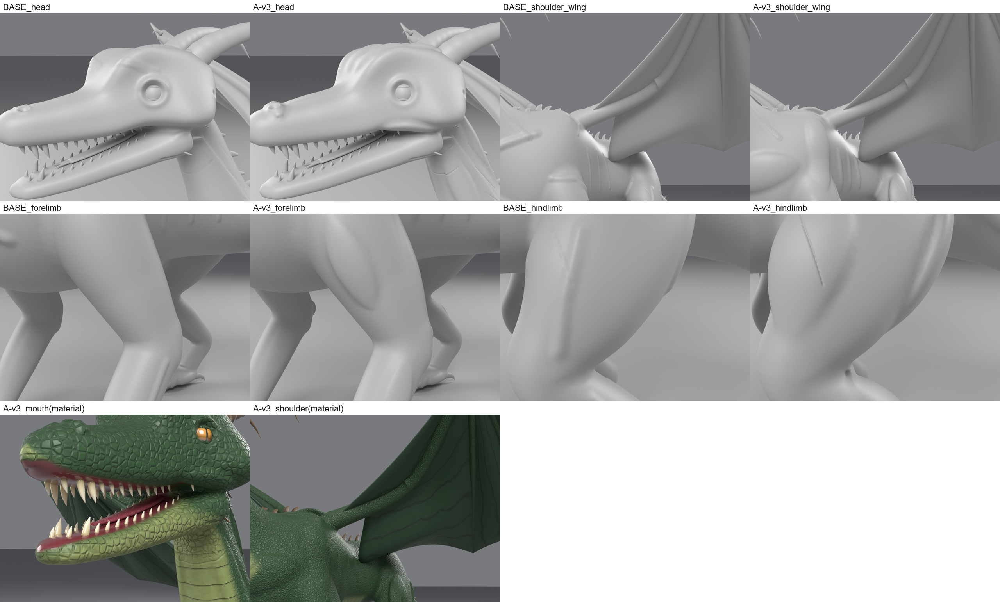

# Phase A: ชั้นกายวิภาค + ขั้น high-poly

**สถานะ: ผ่าน gate แบบมีข้อจำกัด**

รูปทรงชั้นรอง (กล้ามเนื้อ, เอ็น, จุดสังเกตกระดูก) เพิ่มขึ้นชัดเจนทั้งในตัวเลขและในภาพ clay แต่หัวยังเรียบเกินไปและห่วงรอบตายังอยู่ สองเรื่องนี้ส่งต่อให้ Phase D

## สิ่งที่เพิ่มใน skill (ทดสอบแล้ว)

| ส่วน | สิ่งที่ทำ |
|---|---|
| `creature_kit.anatomy_volumes` | กล้ามเนื้อ เอ็น สันกระดูก และปุ่มกระดูก แต่ละชิ้นยึดกับผิวด้วยการยิงเรย์ 2 จุด และฉายตามผิวทุกช่วง มีกลไกป้องกัน 3 ชั้น: จุดยึดห่างเป้าเกินกำหนด, เส้นทางหลุดออกจากผิว, เรย์เริ่มในแขนขาข้างอื่น เมื่อเข้าเงื่อนไขจะข้ามชิ้นนั้นและบันทึกเหตุผล ไม่เดา |
| หลอมสองขั้น | หลอม loft ก่อน → cavity fillet 30 รอบ → หลอม volume ด้วย voxel อีกรอบ → fillet เบาๆ 14 รอบ |
| ขั้น high-poly | หลังปั้นชั้นรอง subdivide จาก 450k เป็น 1.8M faces (ความละเอียดประมาณ 1.6 มม.) แล้วปั้นรอยพับละเอียดบน mesh นี้ body field ถูก interpolate ตามไปด้วย game mesh สร้างจาก mesh ชั้นรอง แต่ bake จาก high-poly |
| `<name>_primary.blend` | เก็บรูปทรงหลัก (loft อย่างเดียว) ไว้เป็นจุดอ้างอิงของ metric |
| `quality_metrics.py --ref` | วัด **added form** คือระยะที่ผิวสุดท้ายนูนออกจากรูปทรงหลัก แยกตามส่วนของตัว |
| `render_details.py --clay` | เรนเดอร์ close-up แบบไม่มี material |
| ฟัน | จำกัดตำแหน่งแนวฟันด้วยผนังแก้มด้านใน ฟันจึงไม่หลุดออกนอกปากเมื่อแก้มหนาขึ้น |
| `CREATURE_OUT_DIR` | ให้ build เขียนไฟล์นอกโฟลเดอร์ skill |
| `examples/dragon/` | มังกรตัว benchmark ย้ายมาใช้ kit พร้อม volume 26 ชิ้นต่อข้าง แทน stroke กล้ามเนื้อเดิม 17 เส้น |

## ผลเทียบ baseline (มังกร Exp 6)

| วัด (เฉพาะ geometry) | Baseline | Phase A v3 |
|---|---|---|
| Added form p90 ทั้งตัว | 0.14 mm | **7.15 mm** |
| แยกส่วน p90: หัว / คอ+อก / ลำตัว / สะโพก+หาง | 0.74 / 0.94 / 0.11 / 0.09 mm | **5.97 / 10.41 / 3.70 / 8.51 mm** |
| High-poly ของลำตัว | 890k tris @ 3.2 mm | 3.6M tris @ 1.56 mm |
| Shell / non-manifold (high-poly) | 1 / 0 | 1 / 0 |
| Stroke เข้าเป้า | 41/41 | 24/24 (17 เส้นถูกแทนด้วย volume) |
| ฟัน / กรงเล็บต่ำสุด | 26 / +1.1 mm | 26 / +1.1 mm |
| เวลา build (GUI) | 122 s | 155 s |

## รอบแก้ (ทุกรอบเก็บไว้ใน `phaseA/`)

| รอบ | สิ่งที่เห็นในภาพ | สาเหตุที่วิเคราะห์ได้ | สิ่งที่แก้ |
|---|---|---|---|
| v1 | ต่างจาก baseline น้อยมาก, ลูกสะบ้าเป็นก้อนแปะ, ฟันโผล่นอกมุมปาก | volume นูนแค่ 5–12 mm และหลอมก่อน fillet 30 รอบจึงถูกลบเกือบหมด; แก้มที่หนาขึ้นทำให้เรย์วัดความกว้างกรามผิด | หลอมสองขั้น, เพิ่มความนูนราว 2 เท่า, ใช้ผนังแก้มด้านในกำหนดแนวฟัน |
| v2 | กล้ามชัดขึ้น แต่มี "เสา" ผิวหนังเชื่อมกรามบนกับล่าง, ลูกสะบ้ากลายเป็นจุดบีบแหลม, กล้ามอกดูเป็นวงรีแปะ | เส้นทางของสันริมปากกระโดดข้ามช่องปากที่อ้า; ปุ่มกระดูกอยู่ตรงจุดที่ 3 volume มาบรรจบกัน; หน้าตัดลึกเกินทำให้ขอบชัน | ตัวป้องกันเส้นทางหลุดผิว, ตัดสันริมปากและลูกสะบ้าออก, depth 0.6 → 0.45, fillet 14 รอบ |
| v3 | ไม่มีเสาเชื่อมกรามและไม่มีจุดบีบ; ต้นขา แขน และสะบัก/อกอ่านเป็นกล้ามเนื้อ; มีสันคิ้ว สันกระหม่อม และปุ่มจมูก | – | ตัวป้องกันข้าม masseter ไป 1 ชิ้น (เส้นทางหลุดผิวใกล้มุมปาก) |

**Metric ก็ต้องแก้ด้วย:** ค่า relief p90 ทั้งตัววัดกล้ามเนื้อไม่ได้ (v2 วัดได้ *ต่ำกว่า* baseline ทั้งที่ภาพ clay ดีขึ้นชัด) เพราะค่านี้ถูกส่วนบางๆ อย่างนิ้วและปลายหางครอบงำ จึงเปลี่ยนมาใช้ added form เทียบกับรูปทรงหลัก

## ข้อจำกัดที่ยังเหลือ

- **หัว:** เพิ่มสันกระดูกแล้วแต่ยังดูเป็นท่อเรียบ, ห่วงรอบตายังอยู่, masseter ถูกข้าม → Phase D (หัว, เขา, ตา)
- **กล้ามอก:** ยังดูคล้ายแผ่นวงรีเล็กน้อย ควรแตกเป็นหลายมัด (clavicular/sternal) ในรอบถัดไป
- **ผิวยังเรียบในระดับเกล็ด:** relief ละเอียด p90 0.02 mm ซึ่งเป็นงานของ Phase B
- **Volume ยังกำหนดด้วยมือ:** พิกัดในข้อมูล 26 ชิ้นตั้งด้วยมือ ตัวป้องกันกันไม่ให้วางผิด แต่ไม่ได้ช่วยหาตำแหน่งให้
