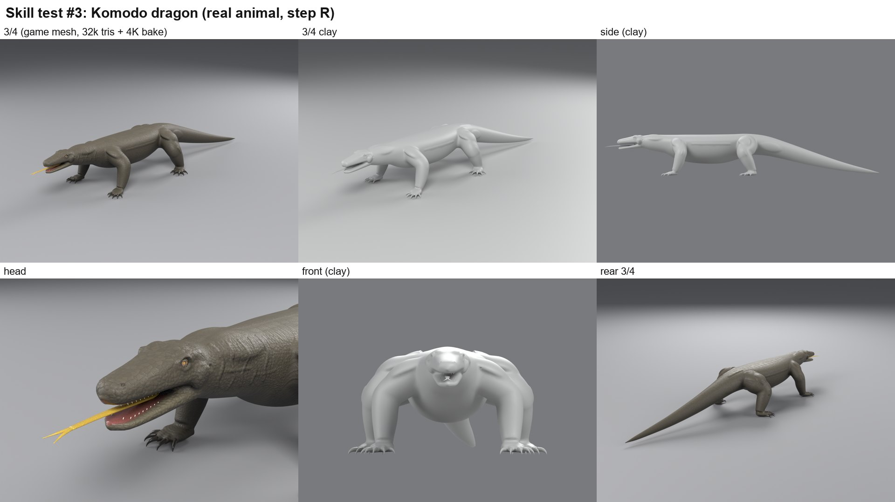
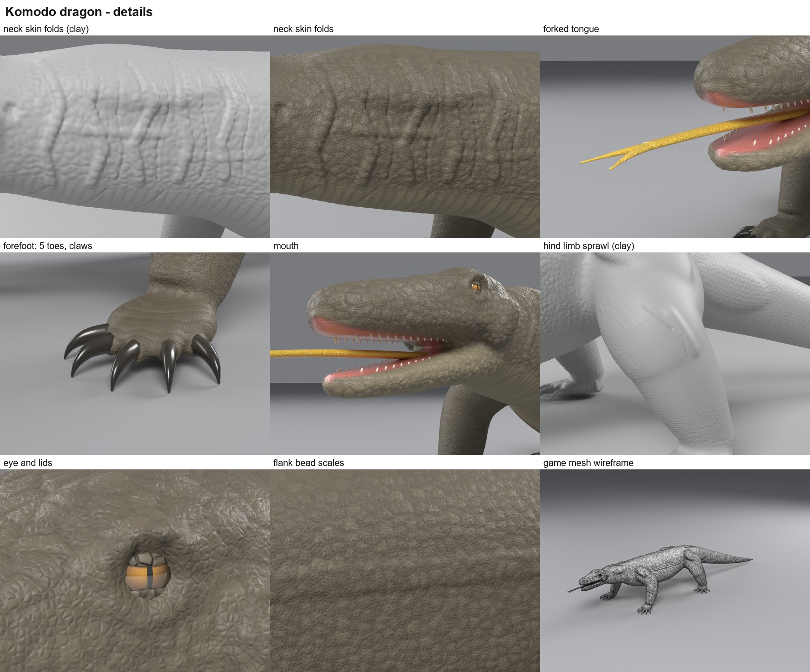

# ทดสอบตัวที่ 3: มังกรโคโมโด (สัตว์จริง สร้างด้วยขั้น R)

**สถานะ:** สร้างสำเร็จด้วย skill v1.2.0 ตรวจด้วย build เต็มแล้ว ใช้เป็นตัวอย่างใน skill ได้ ([`examples/komodo/`](../../plugins/hybrid-creature-modeling/skills/hybrid-creature-modeling/examples/komodo/)) แต่ยังมีข้อบกพร่องเล็กๆ ตามที่ระบุไว้ท้ายหน้า

เลือกโคโมโดเพราะเป็นสัตว์จริง จึงเทียบกับสแกนจริงได้ตรงๆ และใช้ทดสอบขั้น R ได้ครบ อีกทั้งรูปร่างต่างจากมังกรและ raptor ชัดเจน คือขากางออกข้าง ตัวเตี้ยติดพื้น หางยาว และไม่มีปีกหรือเขา

## Reference (ขั้น R)

| ประเภท | โมเดล | ผู้สร้าง | Licence |
|---|---|---|---|
| สัตว์จริง | [Komodo Dragon NHMW-ZOO-HS-23783](https://sketchfab.com/3d-models/09a82ad5c86e44abbcc1f37c2f862042) | Natural History Museum Vienna | CC BY-NC |
| สัตว์จริง | [American Alligator NHMW-ZOO-HS-15682](https://sketchfab.com/3d-models/998086fa2efc4476917191afc8e60c93) | Natural History Museum Vienna | CC BY-NC |

เปิดดูในเบราว์เซอร์อย่างเดียว ไม่ได้ดาวน์โหลด ภาพที่จับหน้าจอมาไม่ได้อยู่ใน repo นี้ ตัวเลขของ reference เป็นค่าประมาณจากภาพหน้าจอ

## ขั้นตอนและสิ่งที่แก้ตาม reference

| รอบ | ผลเมื่อเทียบกับสแกน | สิ่งที่แก้ |
|---|---|---|
| dry run 1 | ตัวบาง: ความลึกลำตัวราว 0.34 เท่าของระยะไหล่ถึงสะโพก (สแกนประมาณ 0.45–0.5), ขาดูยาวเหมือนตุ๊กแก, หัวคล้ายจระเข้ | ท้องลึกขึ้น 32–40%, ขาหนาขึ้น 20–32%, คอหนาขึ้น 15%, โคนหางหนาขึ้น 25%, จมูกทู่และกะโหลกลึกขึ้น, ขากรรไกรล่างกว้าง 87–89% ของขากรรไกรบน |
| dry run 2 | ใกล้สแกนขึ้นชัดเจน กล้ามเนื้อหางชิ้นหนึ่งถูกข้ามเพราะเรย์ชนต้นขาก่อน | ย้ายจุดยึดไปหลังต้นขา และใช้เรย์สั้นลง |
| build 1 | รอยพับคอเป็นเส้นกรีดตรงเรียงเป็นตาราง, ลูกตา 11 mm เล็กกว่าเบ้า 13 mm จึงดูเหมือนลูกบอลจมในหลุม | — |
| build 2 | คอเป็นม้วนผิวหนังนูน มีร่องคั่นแบบไม่สม่ำเสมอ, ตาเต็มเบ้าและหนังตาบนปิดลงมา | ม้วนผิวหนัง (Clay ลึกราว 3 mm) บนเส้นทางคดและระยะห่างไม่เท่ากัน แล้วกรีดเฉพาะร่องระหว่างม้วน; ตา 13.5 mm |

## ผล build 2

| การตรวจ | ผล |
|---|---|
| Build | ไม่มี error ใช้เวลา 93 วินาที (GUI) |
| Anatomy volume | วางได้ 6 จาก 6 |
| เส้นที่ปั้น | ได้ความลึกตามเป้าทุกเส้น (ม้วนคอ 2.9–3.2 mm เป้า 3, ร่อง 2.0 mm เป้า 1.8) |
| ฟัน | บน 13 ล่าง 9 ข้าม 3 ซี่ (ช่องปากแคบเกินไป) |
| ลิ้นแฉก | insert ที่เขียนเอง ยื่นพ้นปลายจมูก 30 mm |
| กรงเล็บ | ต่ำสุด 1.1 mm เหนือพื้น |
| High-poly | 1.87M tris, ขอบเฉลี่ย 1.66 mm, fine relief p90 0.31–0.42 mm ตามส่วน (เกล็ด 8 mm สูง 1.1 mm) |
| Game mesh | 32k tris, ผิวปิดชิ้นเดียว, ไม่มี non-manifold edge, คลาดจาก high-poly สูงสุด 4.4 mm เฉลี่ย 0.06 mm (เกณฑ์ ≤ 12 / ≤ 2 mm), bake 4K |
| Bounding box | 0.80 × 2.80 × 0.43 m อยู่ใน reference box |

ตัวเลขดิบอยู่ใน [`komodo/`](komodo/)

## ข้อบกพร่องที่ยังเหลือ

- หนังตาล่างยังปิดตาน้อยไป
- มีรอยกรีดสั้น 2 รอยบนต้นขาหลัง จากเส้นปั้นรอยพับขาหนีบและหัวเข่าที่วางพลาดตำแหน่ง
- เกล็ดยังลึกน้อยกว่าของจริง และเม็ดเกล็ดที่เล็กกว่า 8 mm ต้องอยู่ใน shader เพราะความละเอียดของ high-poly ไม่พอ
- ท่ายืนเป็นท่าเดิน ไม่ใช่ท่ายกตัวแบบในสแกน จึงเทียบได้เฉพาะสัดส่วนและรายละเอียด ไม่ได้เทียบท่า
