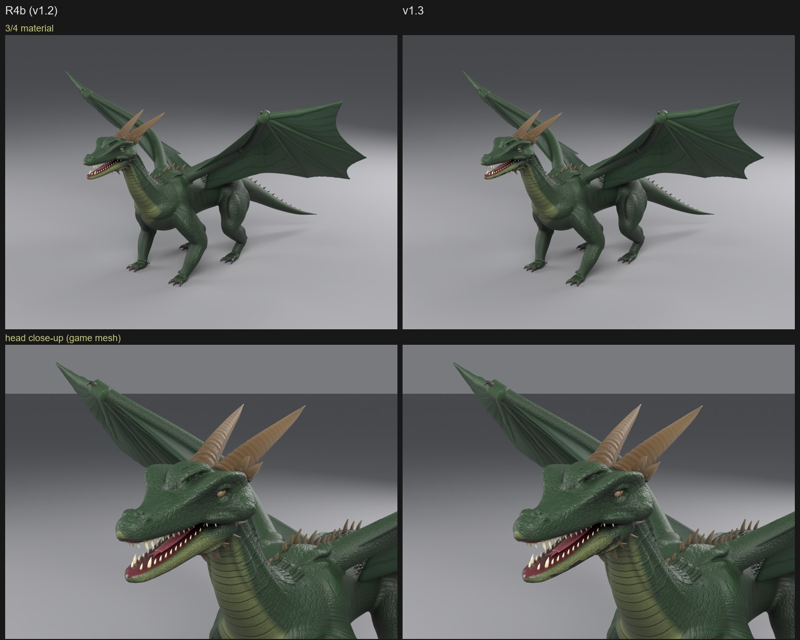
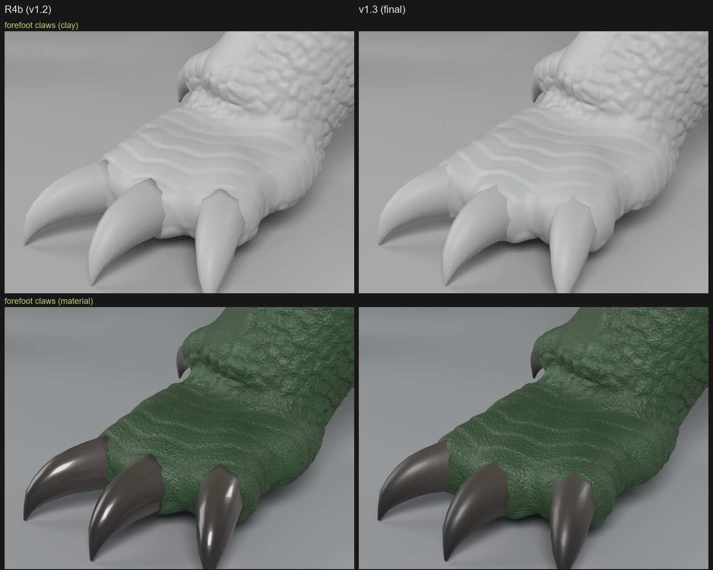
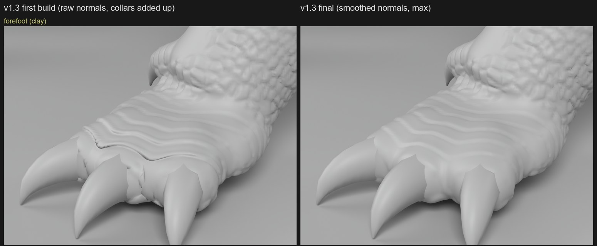
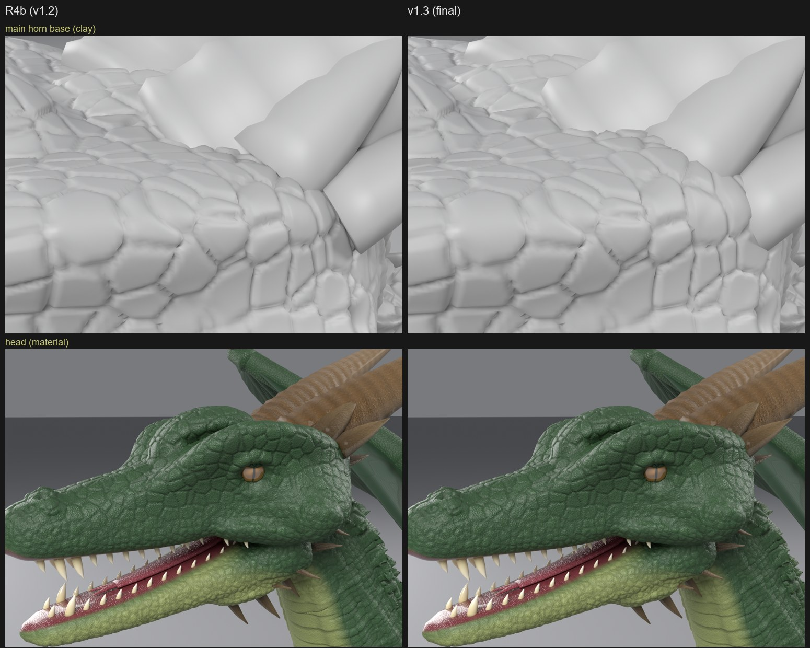
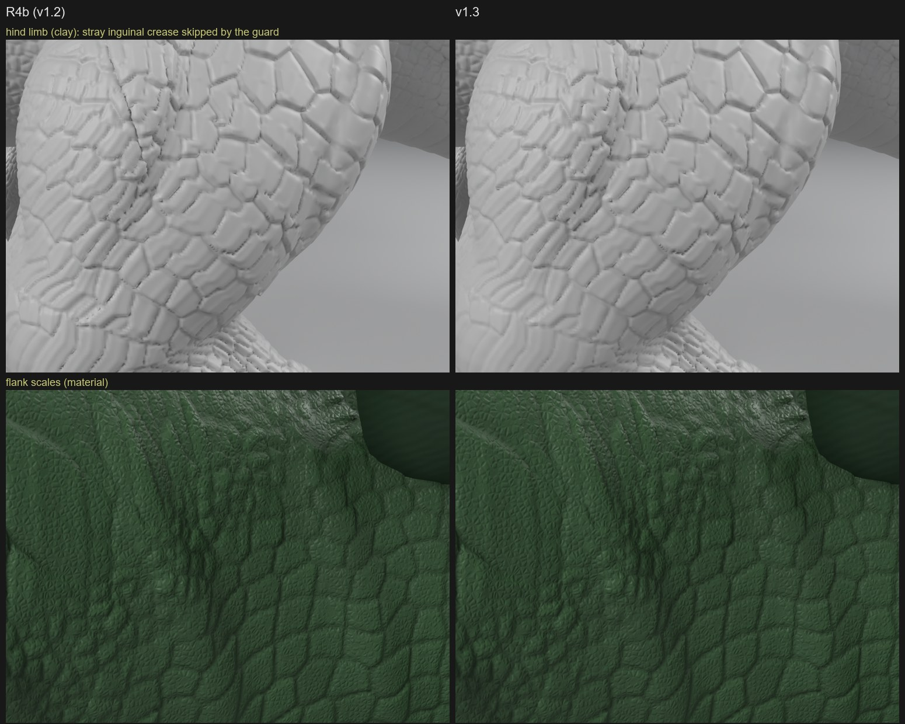

# v1.3: วางแผนผิวตามกายวิภาค, ผิวรอบเขาและเล็บ, วัสดุ, interface ขน

**สถานะ:** เสร็จแล้ว ตรวจด้วย unit test 18 ตัว, dry run ทั้ง 3 ตัวอย่าง และ build มังกรเต็มตัว เทียบกับ R4b (v1.2 ล่าสุด) ด้วยกล้อง แสง และ palette ชุดเดียวกัน

v1.3 เน้นโครงสร้างของ skill มากกว่าการเปลี่ยนหน้าตามังกร ภาพทั้งตัวจึงแทบเหมือน R4b แต่ระยะใกล้ต่างชัดใน 3 จุด: ผิวหุ้มโคนเล็บและโคนเขา, เล็บไม่มันเหมือนเคลือบเงา, และรอยพับที่เคยกรีดผิดที่บนต้นขาหายไป

## ก่อน v1.3: R4 (งานที่ค้างจาก benchmark)

| ค่าที่วัด (high-poly) | R3 | R4b | เป้า |
|---|---|---|---|
| Fine relief p90 (หัว-คอ / อก / ลำตัว / สะโพก / หาง), mm | 0.43 / 0.50 / 0.53 / 0.46 / 0.47 | 0.57 / 0.59 / 0.63 / 0.56 / 0.58 | ≥ 0.5 ทุกส่วน: **ผ่าน** (เดิมผ่าน 2 จาก 5) |
| สันคิ้วยื่นพ้นตา | 26.1 mm | 30.7 mm | ≥ 30: **ผ่าน** |
| Dome index | 0.568 | 0.489 | ≤ 0.55: **ผ่าน** |

R4 เพิ่มม้วนผิวหนังที่คอ, เกล็ดสีข้างเรียงเป็นแถว (`flank_rows`), เกล็ดลึกขึ้น, เกล็ดหลังเรียงเป็นแถวขวาง, สันคิ้วหนักขึ้น, กะโหลกต่ำลง, เขาท้ายกะโหลกและหนามแก้มอย่างละ 4 ต่อข้าง

## สิ่งที่เพิ่มใน v1.3

| ส่วน | สิ่งที่ทำ | ค่าเริ่มต้น |
|---|---|---|
| A: Surface plan | `surface_plan.py` กำหนดว่าผิวแบบไหนอยู่ตรงไหน 20 ส่วน แต่ละส่วนมี region_id, anatomical_role, primary_form, surface_type, detail_scale, coverage_density, surface_orientation, material_profile, geometry_strategy, deformation_requirements | plan เริ่มต้นตรงกับ v1.2 ทุกอย่าง (มีเทสต์ยืนยัน) |
| B: Stroke guard | ข้ามเส้นปั้นที่เรย์ไปชนชิ้นส่วนอื่นข้างหน้า เมื่อจุดที่ชนอยู่ห่างจากจุดที่ตั้งไว้เกิน 4 เท่าของรัศมีแปรง แล้วบันทึกใน log | เปิด |
| B: Skin collar | ผิวพองรอบโคนเขา หนาม และเล็บ (59 จุดบนมังกร) | ปิด (มังกรเปิด) |
| B: `follow_chains` | ย้ายจุดยึดกล้ามเนื้อและเส้นปั้นตามแขนขาที่ขยับ ย้ายจากมังกรเข้ามาใน kit | – |
| C: Joint relief | field `w_joint` ที่ข้อศอก เข่า ข้อมือ; เกล็ดตรงนั้นสูงครึ่งเดียว | ปิด (มังกร 0.5) |
| C: สอบเทียบ metric | วัดว่า relief metric เห็นลายขนาดไหน ด้วยผิวที่รู้ความสูงจริง และเพิ่ม `relief_band_30mm` | เกณฑ์เดิมไม่เปลี่ยน |
| D: วัสดุ | variant เช่น `claw:matte`, `tooth:enamel`, `body:sss` เลือกผ่าน plan; แก้ palette ค้างข้าม build | ค่า v1.2 (มังกรใช้ 3 variant) |
| E: Interface ขน | ฟิลด์ `fur` (ความยาว, ความหนาแน่น, clump, curl, frizz, ...) ตรวจค่าและบันทึก log ผูกกับ node group ขนของ Blender 5.2 | ไม่สร้างขนจริง |

## ผลเทียบกับ R4b

| ค่าที่วัด | R4b | v1.3 |
|---|---|---|
| Fine relief p90 (5 ส่วน), mm | 0.57 / 0.59 / 0.63 / 0.56 / 0.58 | 0.57 / 0.56 / 0.61 / 0.52 / 0.56: ผ่าน 5/5 |
| Band 30 mm p90 (5 ส่วน), mm | 0.75 / 0.71 / 0.75 / 0.73 / 0.74 | 0.74 / 0.68 / 0.73 / 0.68 / 0.72 |
| Added form p90 หัว / ทั้งตัว | 11.9 / 8.7 mm | 12.7 / 9.1 mm |
| สันคิ้ว / dome | 30.7 mm / 0.489 | 30.7 mm / 0.489 |
| Game mesh คลาดสูงสุด / เฉลี่ย | 2.6 / 0.12 mm | 2.4 / 0.12 mm |
| เส้นปั้นที่ตกผิดที่ | crease 4 เส้นตกห่างจุดที่ตั้งไว้ 4–13 cm | guard ข้ามและบันทึกทั้ง 4 เส้น |

เกล็ดที่สะโพกต่ำลงเล็กน้อย (0.56 เป็น 0.52 mm) เพราะ joint relief ที่เข่า แต่ยังผ่านเกณฑ์

### เล็บ

ใน R4b เล็บโผล่จากรอยตัดสี่เหลี่ยมที่ปลายนิ้ว ใน v1.3 ปลายนิ้วพองขึ้นหุ้มโคนเล็บนุ่มกว่า (ดีขึ้นปานกลาง ขอบรอบเล็บกลางยังเป็นเหลี่ยม) เล็บแบบ `claw:matte` ไม่มันเหมือนเคลือบเงาแล้ว

build แรกของ v1.3 ทำให้เท้าแย่ลง: ผิวระหว่างนิ้วยับและมีสันพาดขวางหลังเท้า สาเหตุคือ collar ดันผิวตาม normal ดิบที่เอียงตามเม็ดเกล็ด และ collar ของเล็บที่อยู่ติดกันบวกกัน แก้โดยทำ normal ให้เรียบในรัศมี 6 mm และให้ collar ที่ซ้อนกันใช้ค่าที่สูงกว่า พร้อมเพิ่มเทสต์ตามอาการทั้งสองแบบ

### โคนเขาและหัว

ใน R4b เขาท้ายกะโหลกชนผิวเป็นขอบคมและมีช่อง ใน v1.3 ผิวนูนขึ้นมาหุ้มโคนเขา ภาพหัวแบบมีสีแทบเหมือนเดิม ผิวสว่างขึ้นเล็กน้อยจาก SSS และฟันมันน้อยลง

### ขาหลังและสีข้าง

ใน R4b มีรอยพับขาหนีบที่ตกผิดที่กรีดลงมาบนต้นขา v1.3 ไม่มีแล้ว (guard ข้ามเส้นนั้น) สีข้างเหมือนเดิม

## สิ่งที่พบระหว่างทาง

- **Guard แบบระยะคงที่ใช้ไม่ได้:** เกณฑ์แรก (40 mm) ข้ามเส้นปั้นดีๆ ไป 7 เส้น เช่น Smooth ที่วางจุดไว้ตามแกนขาซึ่งตกบนผิวขาตามที่ตั้งใจ วัดทุกเส้นของมังกรและโคโมโดแล้วพบว่าเส้นใหญ่ตกห่างไม่เกิน 2.3 เท่าของรัศมีแปรง ส่วน crease ที่ตกผิดที่ห่าง 5.5–21 เท่า จึงเปลี่ยนเป็นเกณฑ์ 4 เท่าของรัศมี
- **Relief metric เห็นแค่ลายเล็ก:** ที่ขอบ mesh 1.69 mm, fine relief รายงานความสูงลาย 5 mm ได้ 84–96%, ลาย 10 mm 25–76%, ลาย 20 mm ขึ้นไปเกือบ 0 ส่วน medium ก็ตัดที่ช่วงเดียวกัน เพราะจุดตัดของ Taubin ขึ้นกับ λ/μ และขนาดขอบ ไม่ขึ้นกับจำนวนรอบ เกณฑ์ 0.5 mm จึงวัดความคมของร่องเกล็ดและเกล็ดเล็ก ไม่ใช่ความสูงของเกล็ด 15–40 mm ไม่ได้แก้เกณฑ์ แต่เพิ่ม `relief_band_30mm` ที่ช่วงคงที่ไม่ว่า mesh จะละเอียดแค่ไหน
- **Golden test ล้มประมาณ 1 ใน 15 รอบ:** float32 ทำให้ค่าที่อยู่บนขอบการปัดระดับไมโครเมตรพลิกได้ เก็บ array ของ displacement ไว้เทียบที่ 0.1 µm เมื่อ hash ไม่ตรง (hash ที่บันทึกใหม่จากโค้ดก่อนแก้ยังตรงกับค่าเดิม)
- **Bake crash:** RAM เต็มและไดรฟ์ C เหลือน้อยจน page file ขยายไม่ได้ จึงเพิ่มตัวเฝ้าดิสก์ใน build script

## ข้อจำกัดและงานต่อไป

- ยังไม่ได้ build โคโมโดเต็มตัวด้วย v1.3 (dry run ผ่าน) guard ควรข้ามรอยพับขาหนีบ เข่า รักแร้ และข้อศอกที่กรีดต้นขา (วัดได้ 8.7–20.8 เท่าของรัศมี) แต่ยังไม่ได้ยืนยันด้วย build จริง
- crease 4 เส้นที่ถูกข้ามบนมังกรต้องย้ายจุดหรือมุมมองใหม่ถึงจะได้รอยพับกลับมาในที่ที่ถูก
- ขอบรอบโคนเล็บกลางยังเป็นเหลี่ยม
- ยังไม่มีตัวสร้างขนจริง (มีแค่ interface)
- ค้างจากก่อนหน้า: ลำตัวยังสูงกว่า reference, เยื่อปีกยังไม่มีรอยขาด, ข้อมือปีกมีผิวทับกันอยู่ภายใน, สันเกล็ดหลังยังไม่คมเท่าจระเข้
